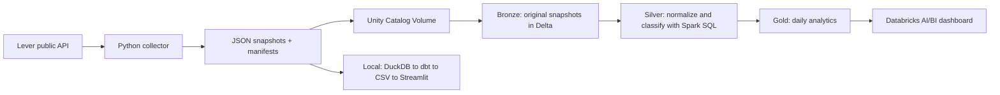
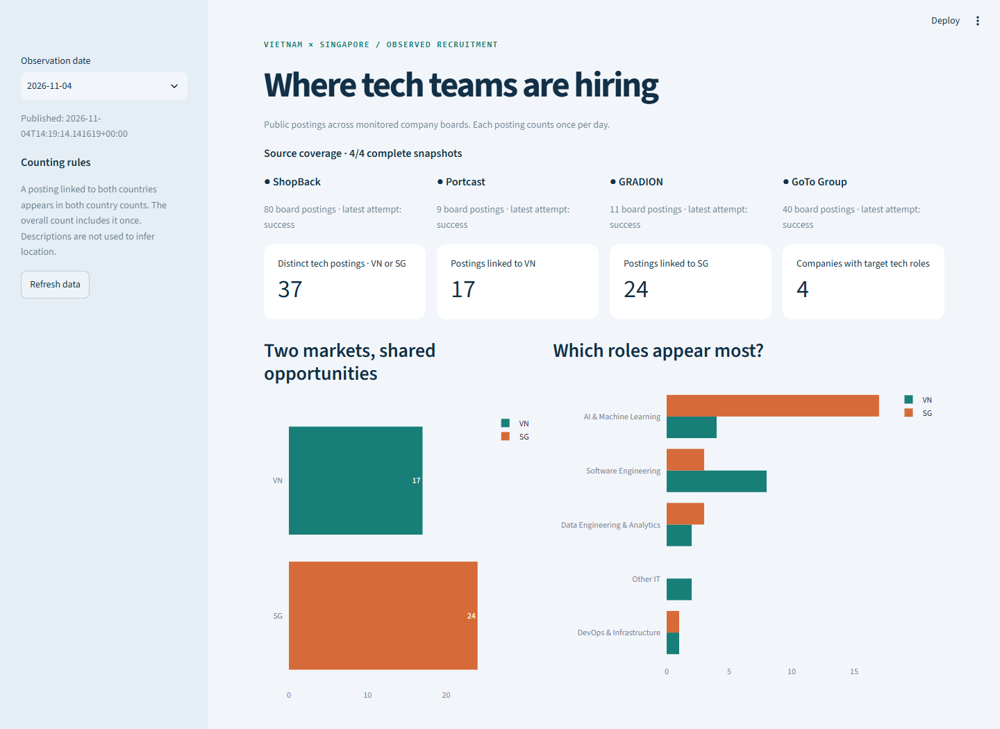

# Tech Jobs Analytics | Vietnam & Singapore

A daily batch pipeline for analyzing technology job postings at selected companies in Vietnam and Singapore. Built with Python, SQL and Databricks Free Edition, with a local version for development and testing.

Developed as a Data Engineering Zoomcamp capstone for the 2027 cohort. See the [project review](docs/project-review.md) for implementation readiness and remaining submission evidence.

## The problem

Company career pages change every day. Manual checks make it hard to compare postings over time. This project preserves each collection, applies consistent counting rules and prepares dashboard datasets to answer:

- How many technology postings were observed on each date?
- Which countries, companies and role categories have these postings?
- Did counts change, or did a source fail to provide data?

**Scope:** public Lever postings from monitored companies, not the entire job market. One posting can advertise several vacancies; a disappearing posting does not prove a hire.

## Live deployment

- [Published Databricks dashboard](https://dbc-63d22f94-de5b.cloud.databricks.com/dashboardsv3/01f1d86a4cca1c06a507828d58ab629f/published?o=7474648485286956)
- [Verified successful pipeline run](https://dbc-63d22f94-de5b.cloud.databricks.com/?o=7474648485286956#job/468351600295439/run/732812466979937)
- [Deployment evidence](docs/databricks-deployment.md): five tasks succeeded, active 07:00 daily collection, six real observation dates and full source coverage.

Verified on 2026-11-09: **29 distinct technology postings**, 9 linked to VN and 24 to SG, with 4/4 sources complete. Four postings link to both countries. Dashboard viewing requires appropriate Databricks access; publication preserves existing permissions.

## Architecture



The deployed Databricks Job collects directly from Lever, saves snapshots in a Volume and builds the analytical tables. A local collector/upload path is available when workspace network access blocks Lever. See [architecture and data rules](docs/architecture.md).

| Tool | Its job in this project |
|---|---|
| Python | Fetch API pages, validate responses and preserve snapshots |
| Unity Catalog Volume | Store original JSON files in the cloud |
| Delta Lake | Store tables with transactional writes |
| Spark SQL | Build normalized data and daily metrics on Databricks |
| Databricks bundle / Jobs | Define resources as code and run notebook tasks in order |
| AI/BI dashboard | Visualize Gold tables using a versioned dashboard asset |
| DuckDB / dbt / Streamlit | Run the same business rules and a dashboard locally |

An optional [GCP implementation](docs/optional/gcp.md) uses GCS, BigQuery, Terraform, Kestra and Looker Studio.

## Quick start: run locally first

Install Git, Python 3.11–3.13 and [uv](https://docs.astral.sh/uv/getting-started/installation/). Clone the repository and run commands from its root, where `pyproject.toml` lives.

```bash
git clone https://github.com/Tanh2k8-123/jobs-it-vn-sg-data-pipeline.git
cd jobs-it-vn-sg-data-pipeline
uv sync --frozen
uv run sea-it-jobs pipeline --target local
uv run streamlit run dashboard/app.py
```

Open the printed URL, usually http://localhost:8501. Stop with `Ctrl+C`. If the port is busy, add `--server.port=8502`.

The pipeline fetches live data, saves snapshots, loads DuckDB, runs dbt models/tests and exports dashboard CSVs. It needs internet access but no cloud account. The first collection provides one observation date; a real trend needs collections on later days.



Optional settings live in `.env.example`. Copy it to `.env` when customizing paths or using cloud/Docker: `cp .env.example .env` on Linux/macOS, or `Copy-Item .env.example .env` in PowerShell. Keep `.env` out of Git.

### Offline demo

After installing dependencies, the demo needs no API or cloud account:

```bash
uv run sea-it-jobs demo
```

Start its dashboard on Linux/macOS/WSL:

```bash
DATA_DIR=data/demo uv run streamlit run dashboard/app.py
```

Or in PowerShell:

```powershell
$env:DATA_DIR = 'data/demo'
uv run streamlit run dashboard/app.py
# After stopping the dashboard:
Remove-Item Env:DATA_DIR
```

Demo data stays in `data/demo/` and is labeled synthetic. Its dates are fixtures, not market history.

### Move to Databricks

Follow the [Databricks setup](docs/deployment/databricks.md): install the CLI, sign in, review the deployment plan, deploy the bundle and run the Job. The bundle includes the [dashboard](docs/deployment/dashboard.md).

The bundle defines three schemas, a managed Volume, a dashboard and five tasks: `setup → ingest_bronze → build_silver_gold → quality_checks → refresh_dashboard`. The verified deployment uses API collection and runs daily at 07:00 Vietnam time. Pause the schedule before testing a new workspace. In Volume mode, schedule the collector too; running only the Job does not fetch new data.

## Read the numbers correctly

- A posting linked to both VN and SG counts in both country totals but once overall.
- A successful empty response means zero postings. A failed or missing source means unavailable data.
- Each board/date uses its latest complete successful snapshot. A later failure keeps an earlier same-day success; a later successful empty run replaces it.
- Previous days are never carried forward. Check the observation date and source coverage before comparing dates.
- Roles use title rules; countries use explicit country/location fields. Unknown or ambiguous locations stay outside target metrics.

The source roster in `config/boards.csv` includes ShopBack, Portcast, GRADION and GoTo Group. Audit a new board before enabling it. See [source audit](docs/source-audit.md) and [model definitions](docs/architecture.md#data-model).

## Documentation

| Guide | What it covers |
|---|---|
| [Documentation index](docs/README.md) | Guide selection and the public documentation layout |
| [Architecture](docs/architecture.md) | Data model, counting rules, storage and limitations |
| [Runbook](docs/runbook.md) | Commands, retries, replay and troubleshooting |
| [Databricks setup](docs/deployment/databricks.md) | Authentication, deployment, execution and scheduling |
| [Validation](docs/validation.md) | Executed checks and missing deployment evidence |
| [Live deployment evidence](docs/databricks-deployment.md) | Actual Job, dashboard, schedule and warehouse query results |
| [Project review](docs/project-review.md) | Assessment against the supplied Zoomcamp rubric |
| [Submission checklist](docs/submission-checklist.md) | Evidence needed before peer review |
| [GCP](docs/optional/gcp.md) / [Kestra](docs/optional/kestra.md) / [Looker Studio](docs/optional/looker-studio.md) | Optional alternative deployment |

## Development checks

```bash
uv sync --frozen --extra cloud --extra dev --extra databricks
uv run ruff check src tests dashboard scripts
uv run pytest -q
uv run python scripts/render_databricks_sql.py
uv run python scripts/compile_bigquery_offline.py
docker compose config --quiet
```

Tests cover API failures, pagination, snapshot corruption, replay, multi-country counting, source coverage and shared SQL rendering. Cloud clients are mocked. CI also validates Terraform. See [validation](docs/validation.md) for evidence and limits.

**Status:** deployed and verified on Databricks Free Edition. Direct API ingestion, Bronze/Silver/Gold processing, quality checks and dashboard refresh succeeded in one Job run. Daily collection is enabled. Reviewer-account access and course submission remain separate checks.
