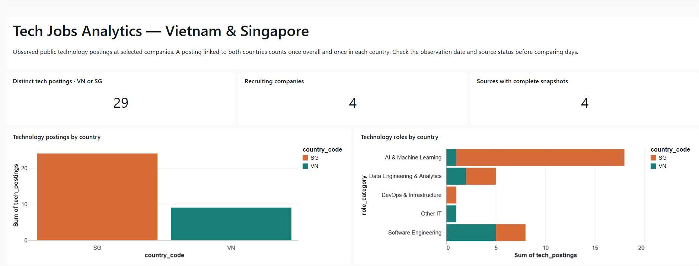
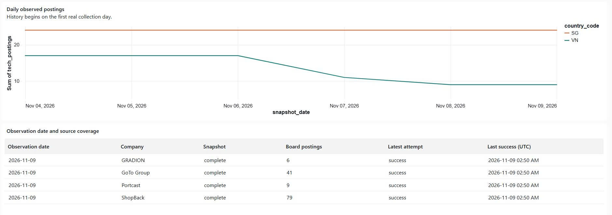
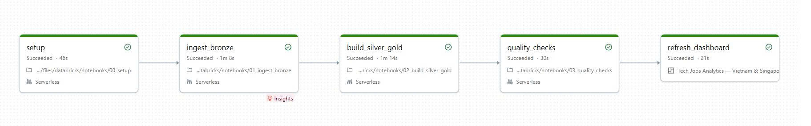

# Live Databricks deployment

Verified on **2026-11-09 (Vietnam time)** through authenticated Databricks APIs, a fresh Job run and SQL queries. The machine-readable [evidence record](databricks-deployment.json) contains sanitized results without credentials.

## Resources and execution

| Item | Verified value |
|---|---|
| Workspace | `dbc-63d22f94-de5b.cloud.databricks.com` |
| Catalog | `workspace` |
| Schemas | `tech_jobs_bronze`, `tech_jobs_silver`, `tech_jobs_gold` |
| Raw Volume | `/Volumes/workspace/tech_jobs_bronze/raw_snapshots` |
| Job ID | `468351600295439` |
| Fresh run ID | `732812466979937` |
| Collection | Direct Lever API from a serverless notebook |
| Schedule | Daily 07:00 `Asia/Ho_Chi_Minh`, `UNPAUSED` |
| Quality | 18 integrity queries plus source coverage and observation freshness |
| Dashboard | Five datasets and eight widgets, including country/role bars, daily trend and source health |

The [fresh pipeline run](https://dbc-63d22f94-de5b.cloud.databricks.com/?o=7474648485286956#job/468351600295439/run/732812466979937) completed with **SUCCESS** for all five tasks:

```text
setup → ingest_bronze → build_silver_gold → quality_checks → refresh_dashboard
```

The [published dashboard](https://dbc-63d22f94-de5b.cloud.databricks.com/dashboardsv3/01f1d86a4cca1c06a507828d58ab629f/published?o=7474648485286956) retains its existing ID and matches the versioned JSON asset. It uses viewer credentials (`embed_credentials=false`). Existing access permissions were preserved; access from a reviewer-equivalent account has not been independently verified.

## Visual evidence

The project owner supplied these original Databricks JPEG screenshots on 2026-11-09. Files were copied byte-for-byte without image processing. File dimensions and SHA-256 checksums are recorded in the [evidence JSON](databricks-deployment.json).

The published dashboard shows 29 distinct technology postings, four recruiting companies and four complete sources, with country and role charts:



The trend covers 2026-11-04 through 2026-11-09. The source-health table renders all four company rows, including left-aligned posting counts and latest-attempt values:



The Job graph shows all five tasks with a Succeeded status. The API-verifiable full pipeline run is linked above:



These screenshots confirm the displayed dashboard and Job graph. They do not establish access from another user's account. A separate schema screenshot has not been supplied; schema and Delta-layout evidence was verified through authenticated APIs and SQL.

## Observed data

Live queries returned six real observation dates, all with complete coverage:

| Date | Distinct target technology postings | Successful sources |
|---|---:|---:|
| 2026-11-04 | 37 | 4/4 |
| 2026-11-05 | 37 | 4/4 |
| 2026-11-06 | 37 | 4/4 |
| 2026-11-07 | 31 | 4/4 |
| 2026-11-08 | 29 | 4/4 |
| 2026-11-09 | 29 | 4/4 |

On 2026-11-09, VN had 9 country-linked postings and SG had 24. Four postings linked to both, so the distinct overall count was 29. All four latest source attempts succeeded. Raw source counts were ShopBack 79, Portcast 9, GRADION 6 and GoTo Group 41; these include roles/countries outside target technology metrics.

`DESCRIBE DETAIL` confirmed Delta format and liquid clustering: Bronze on `(snapshot_date, board_slug)`, and `mart_daily_country` on `snapshot_date`.

## Deployment reconciliation

The workspace already contained successful daily runs when authenticated inspection became available. The local bundle was brought into agreement with that deployment:

- Added the existing dashboard asset and its post-quality refresh task to version control.
- Removed development-mode prefixes that would otherwise rename the schemas separately from notebook parameters.
- Preserved API collection, active scheduling, resource IDs and historical snapshots.
- Reviewed the plan before applying it: **zero resource deletions**. The dashboard was updated and republished, then the fresh full pipeline run succeeded.
- Kept personal study materials excluded from Git and bundle sync.

Local checks after reconciliation passed: **38 tests** and Ruff. Regression tests cover schema naming, dashboard lifecycle dependencies, dataset references and categorical/time charts.

For future deployments, run `bundle validate`, review `bundle plan`, then deploy using the authenticated profile. Use [setup](deployment/databricks.md) and [recovery commands](runbook.md). The legacy target name `dev` identifies the existing state path; it does not enable development-mode naming behavior.

## Source-health table correction

On 2026-11-09, the table widget was migrated from a partial legacy v1 definition to the current v2 definition after a reported empty visualization. Its SQL returned four company rows and all six required columns. The repaired asset was deployed and republished using the same dashboard ID.

The [dashboard-only refresh](https://dbc-63d22f94-de5b.cloud.databricks.com/?o=7474648485286956#job/468351600295439/run/295115851975887) succeeded. This partial run selected only `refresh_dashboard`; ingestion and quality tasks were intentionally not rerun. The original successful five-task pipeline evidence above remains separate. Regression checks now validate widget versions and selected-field bindings; the local suite passed 39 tests. Automated browser capture was unavailable during the fix; the subsequent user-supplied screenshots above confirm that the table renders correctly.
