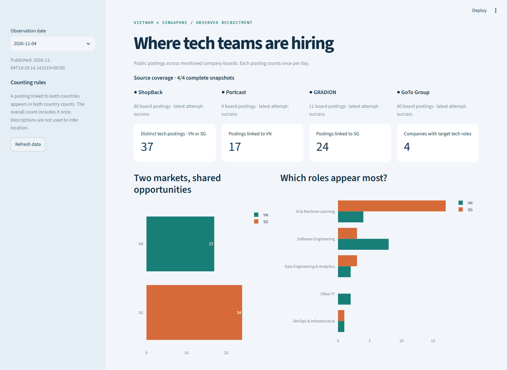

# Local development and dashboard

The selected cloud deployment is [Databricks](../deployment/databricks.md). The local DuckDB/dbt/Streamlit path supports development, offline demonstrations and metric checks without a cloud account.

## Run with live API data

From the repository root after `uv sync --frozen`:

```bash
uv run sea-it-jobs pipeline --target local
uv run streamlit run dashboard/app.py
```

Open the printed URL, usually http://localhost:8501. Stop with `Ctrl+C`; add `--server.port=8502` if the port is busy. Streamlit reads exported CSVs, not the Databricks tables. A fresh local installation needs its own collection or demo data.

## Offline demonstration

After dependency installation, create the isolated synthetic fixture:

```bash
uv run sea-it-jobs demo
```

Start its dashboard on Linux/macOS/WSL:

```bash
DATA_DIR=data/demo uv run streamlit run dashboard/app.py
```

Or in PowerShell:

```powershell
$env:DATA_DIR = 'data/demo'
uv run streamlit run dashboard/app.py
# After stopping the dashboard:
Remove-Item Env:DATA_DIR
```

The demo stays under `data/demo/` and displays a synthetic-data label. Its January dates are test fixtures, not reconstructed market history.

## Historical local screenshot

The image below is the **Streamlit interface running locally**, recorded with the 2026-11-04 real snapshot: 37 distinct target technology postings, 17 linked to VN and 24 to SG. It is a dated local reference, not a screenshot of the deployed Databricks dashboard or a current-data claim.



The rendering code is `dashboard/app.py`. The optional capture helper is `scripts/capture_dashboard.py`; it captures an already-running local Streamlit page using Playwright. Regenerate the image and update its date/count caption together if replacing this reference. Current Databricks evidence is in the [live deployment record](../databricks-deployment.md).
